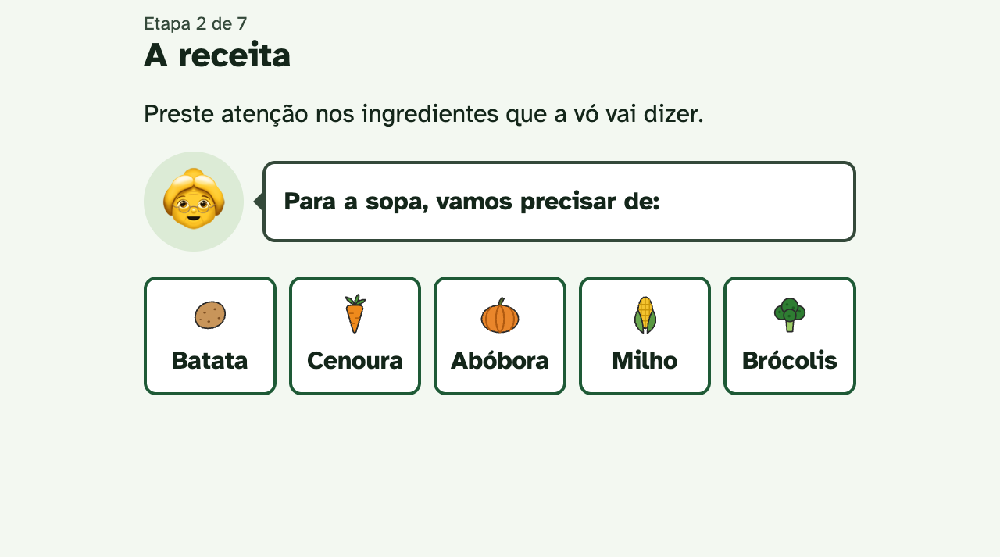
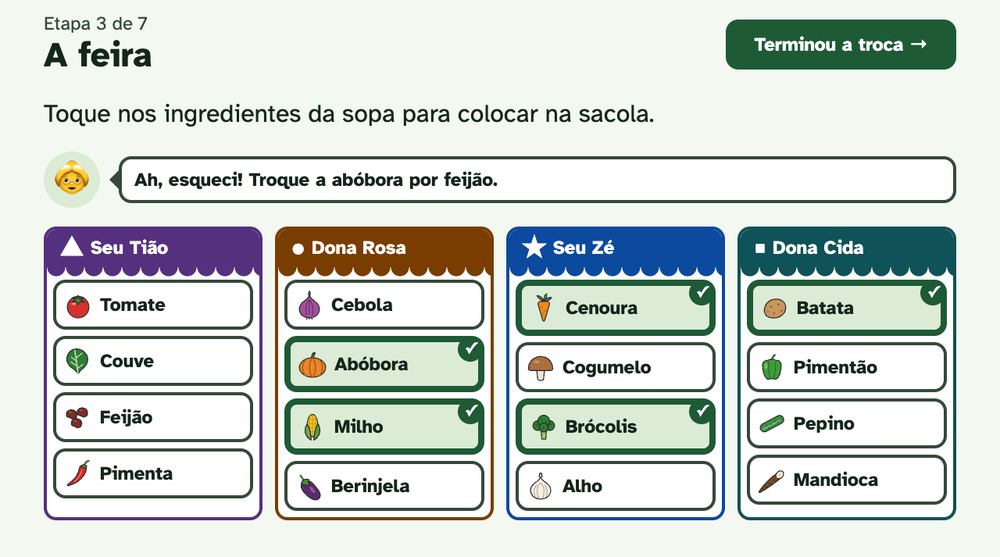
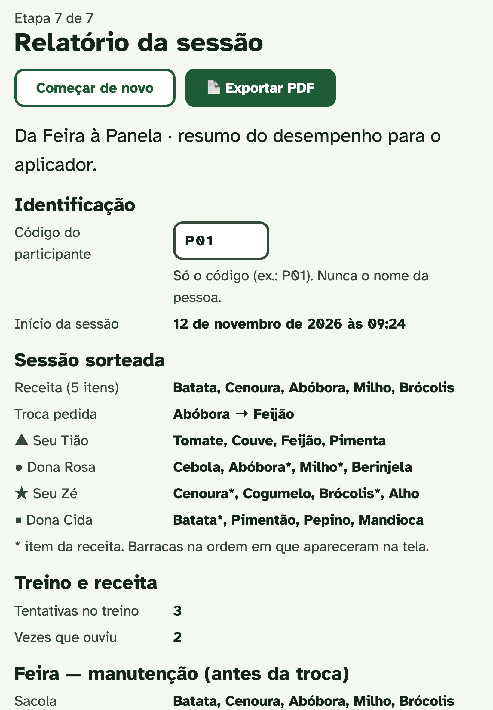

# 🥕 DA FEIRA À PANELA — NEUROGAME LAB

> [!NOTE]
> **Jogo para avaliar e estimular a memória:** web app que avalia e estimula a **memória de trabalho** e a **memória episódica** em adultos e idosos. Foi feito para o trabalho NeuroGame Lab (Neurociência Cognitiva e Reabilitação, Psicologia). Usa React, TypeScript e Vite, com acessibilidade WCAG AAA, sorteio novo a cada partida e relatório em PDF. Não tem backend: os dados ficam no navegador.

O jogo conta uma história do dia a dia: a vó passa a receita da sopa, a pessoa compra os ingredientes na feira, coloca tudo na panela na ordem certa e, depois de um intervalo, lembra como foi o passeio. Quem opera é o **aplicador**. O participante só toca na tela e fala, sem digitar e sem ver cronômetro.

---

## 🎓 Sobre o Projeto

Este é o projeto acadêmico da minha namorada, estudante de Psicologia, para a disciplina de Neurociência Cognitiva e Reabilitação. A apresentação é em novembro de 2026. Ela cuidou da parte teórica e do trabalho escrito, e eu desenvolvi o jogo.

Antes de programar, foi preciso **estudar a teoria**. Pesquisamos artigos sobre memória de trabalho e memória episódica (Baddeley & Hitch, 1974; Baddeley, 2000; Cowan, 2001; Tulving, 2002), envelhecimento (Park et al., 2002; Naveh-Benjamin, 2000), reabilitação cognitiva (aprendizagem sem erro, recordação espaçada) e uso de tecnologia por idosos (Czaja et al., 2019). Também lemos as diretrizes de acessibilidade WCAG 2.2. Cada regra do jogo vem dessa pesquisa: a troca de ingrediente na feira testa a atualização da memória de trabalho, e o almoço com pistas separa falha de codificação de falha de evocação.

### 🤖 Feito com IA

O desenvolvimento foi feito em par com o **Claude Code** (Anthropic). Eu decidia o que construir, validava cada etapa no navegador e fazia os commits. A IA ajudou a escrever o código, a explicar os conceitos de React e TypeScript e a organizar a pesquisa. O trabalho foi dividido em blocos pequenos, e cada um só avançava depois de eu testar e entender.

---

## 🌐 Demonstração

- **Jogo no ar:** [https://da-feira-a-panela.vercel.app](https://da-feira-a-panela.vercel.app)

<div align="center">
  <table>
    <tr>
      <td align="center" width="60%">
        <b>💻 Desktop (Receita / Feira)</b><br><br>
        <br><br>
        
      </td>
      <td align="center" width="40%">
        <b>📱 Tablet (Relatório)</b><br><br>
        
      </td>
    </tr>
  </table>
</div>

---

## 🧠 Como o jogo funciona

| Fase | O que acontece | O que mede |
|---|---|---|
| **Treino** | 3 rodadas sem pontuação para conhecer a tela | Familiaridade digital (nº de tentativas) |
| **1. A receita** | A vó diz 5 ingredientes da sopa e a lista some | Memória de trabalho (retenção) |
| **2. A feira** | Comprar os itens em 4 barracas; no meio, a vó pede uma troca ("troque a batata por mandioca") | Manutenção e atualização: acertos, omissões, intrusões, perseveração |
| **3. A panela** | Colocar os ingredientes na ordem de preparo | Memória sequencial: erros de ordem, pares invertidos |
| **Intervalo** | Busca visual de animais por 5 minutos | Distrator |
| **4. O almoço** | Recordação livre → com pista → reconhecimento → onde → quando | Memória episódica: item × associação, ganho com pista |

O elo teórico entre as fases é o **buffer episódico** (Baddeley, 2000). Errar na feira indica falha de **codificação**. Acertar na feira, errar no almoço e melhorar com a pista indica falha de **evocação**.

---

## 🚀 Stack e Decisões de Arquitetura

- **React + TypeScript (`strict`) + Vite:** só `react` e `react-dom` como dependências. Som, voz, animação e PDF usam APIs nativas do navegador.
- **Máquina de estados com `useReducer`:** as fases são uma união de strings (`src/jogo/fases.ts`) e um reducer único controla o jogo (`estadoDoJogo.ts`). `Record<Fase, ...>` faz o build quebrar se uma fase nova ficar sem texto.
- **Sorteio fora do reducer:** cada partida sorteia a receita (5 entre 16 ingredientes), a troca, os itens de cada barraca e a posição das barracas (`src/jogo/sessao.ts`). O sorteio entra pela ação `reiniciar`, e o reducer continua puro.
- **Dados brutos + indicadores:** o jogo guarda cada toque com o tempo em ms e calcula os indicadores depois, em funções puras (`src/jogo/indicadores.ts`).
- **Design Tokens + CSS Modules:** cores, fontes, espaços e tempos de animação ficam em `src/styles/tokens.css`, e cada componente tem seu `.module.css`.
- **Voz gravada com reserva:** toca o `.mp3` de `public/audio/` e, se o arquivo faltar, usa a síntese de voz do navegador. Tudo funciona com Promise + `AbortSignal`, então dá para encadear falas com `await` e interromper quando a tela muda.
- **Sons com Web Audio:** efeitos sintetizados na hora (`src/som/sons.ts`), sem arquivos. Nas fases que avaliam memória, o som é neutro e não indica acerto nem erro.
- **Animações com propósito:** CSS e Web Animations API, curtas e sem nada piscando mais de 3 vezes por segundo. Tudo desliga com `prefers-reduced-motion`.
- **Relatório em PDF sem biblioteca:** `window.print()` com CSS de impressão, e o nome do arquivo vem do `document.title`.
- **Vercel:** cada `git push` na `main` publica uma nova versão.

---

## ♿ Acessibilidade e Ética

- **Contraste AAA (≥ 7:1)** em todas as cores, fonte **Atkinson Hyperlegible** com 24px ou mais e botões de pelo menos **64px**.
- **Seguro para daltonismo:** a cor nunca aparece sozinha. Cada barraca tem feirante, cor, símbolo e nome, e o feedback usa o eixo azul/âmbar com ícone, texto e som, nunca vermelho/verde.
- **Toque simples:** sem arrastar, sem toque duplo, sem rolagem e sem menus escondidos. O layout foi medido em 1024×768, 1180×820 e 768×1024.
- **Privacidade (LGPD):** o participante é identificado só por um código (`P01`), e um regex bloqueia nomes. Não há backend e **não se usa reconhecimento de fala**, porque no Chrome o áudio vai para o Google, e voz é dado sensível de saúde (art. 11).
- **Original:** usa conceitos da literatura, mas não copia testes comerciais (RAVLT, Corsi, Wechsler).

---

## 🗂️ Estrutura

```
src/jogo/          fases, reducer, sorteio da sessão, ingredientes, barracas e indicadores
src/fases/         uma pasta por tela: Treino, Receita, Feira, Panela, Distrator, Almoco, Resultados
src/componentes/   Botao, TelaFase, FalaDaVo, Feedback
src/voz/           catálogo de falas, player de áudio com reserva e hook useVo
src/som/           efeitos sonoros com Web Audio
src/icones/        ícones SVG dos 16 ingredientes
src/styles/        tokens.css e base.css
public/audio/      gravações da voz da vó (.mp3)
docs/              resumo do projeto para a parte escrita
```

---

## 🛠️ Como Mexer

- **Rodar local:** `npm install` e `npm run dev`, depois abrir http://localhost:5173. No modo dev, o intervalo libera o botão em 15 s em vez de 5 min.
- **Build:** `npm run build` (confere os tipos e gera a pasta `dist/`). Para conferir o layout, use `npm run preview`, porque no dev o CSS carrega aos poucos.
- **Nova fala da vó:** adicionar em `src/voz/falas.ts` e colocar o `.mp3` com o mesmo nome em `public/audio/`.
- **Novo ingrediente:** adicionar em `src/jogo/ingredientes.ts` e criar o ícone em `src/icones/IconeIngrediente.tsx`.
- **Nova fase:** incluir na união `Fase` e em `ORDEM_DAS_FASES` (`src/jogo/fases.ts`). O TypeScript mostra o que falta preencher.

---

## 👨‍💻 Autor

Desenvolvido por **Lincoln Berto**.

- **LinkedIn:** [https://www.linkedin.com/in/lincoln-berto/](https://www.linkedin.com/in/lincoln-berto/)
- **GitHub:** [https://github.com/eilincoln](https://github.com/eilincoln)
- **Portfólio:** [https://www.lincolnberto.com](https://www.lincolnberto.com)
